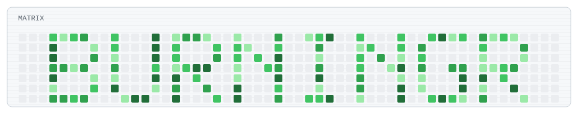

# I research how web applications break.

## Independent security researcher in web application and API security

I conduct manual security research on web applications and APIs, with a focus on authentication, authorization, access control, and business logic. My work spans bug bounty programs on HackerOne and Bugcrowd, as well as private engagements.

---

## Research approach

I start by building an accurate model of the application: its architecture, feature interactions, trust boundaries, and the assumptions its developers made. I then test how those assumptions hold up across different roles, object references, and workflow states. Tools support my investigation and help validate findings, but hands-on analysis remains at the center of my work.

---

## Areas of focus

- Authentication and session management
- Authorization and access control, including object-level and function-level enforcement
- Business logic vulnerabilities and multi-step workflow abuse
- API security, including relationships between endpoints, objects, and roles

---

## Writing

Technical write-ups and methodology notes: [burningresolve.web.id](https://burningresolve.web.id)

---

## GitHub Activity

  

  
  

  <picture>
    <source media="(prefers-color-scheme: dark)" srcset="./dist/readme-arcade-dark.svg">
    <source media="(prefers-color-scheme: light)" srcset="./dist/readme-arcade.svg">
    
  </picture>

